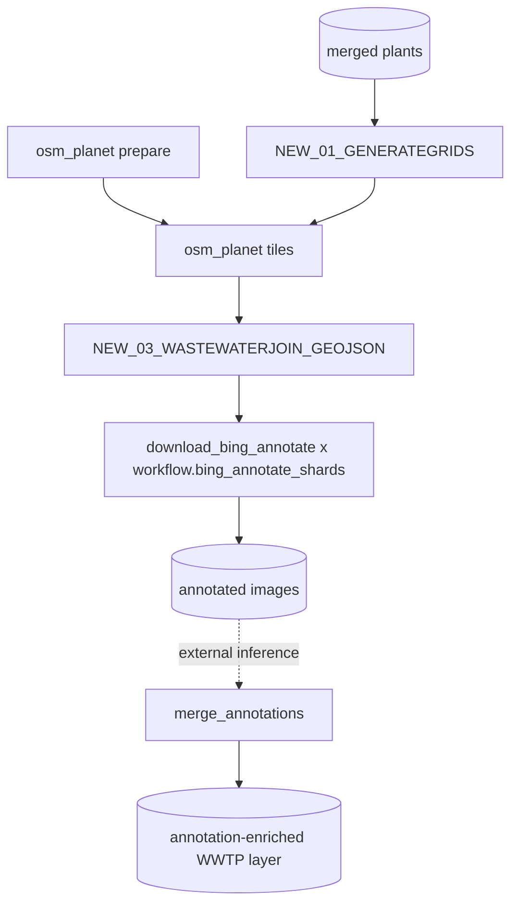

# annotation_scripts

## Sections
| Section | Purpose |
| --- | --- |
| `What This Module Does` | Explains the aim of the annotation stage |
| `How It Fits In` | Shows where this stage sits in the wider workflow |
| `Scripts in This Folder` | Summarises the role, inputs, and outputs of each script |
| `Execution Flow` | Gives a compact visual view of the stage |
| `Run Instructions` | Lists the commands most users will actually run |
| `Smart Behaviors` | Notes implementation details that matter in practice |
| `Parameters` | Collects the configuration settings specific to this stage |
| `Known Issues / TODOs` | Flags current caveats and limitations |

## What This Module Does
This module prepares and merges annotation context around WWTP points. It creates grids, extracts OSM features, renders annotation imagery, and then merges the annotation results back into the corrected WWTP dataset.

## How It Fits In
It runs after the main WWTP merge and before the Voronoi and population stages when annotation-derived context is needed. Its outputs are used for QA, downstream filtering, and explanation of WWTP type labels.

## Required Starter Data Files

Before running this stage, these inputs must be available.

| Data file | Why needed | Default path status |
| --- | --- | --- |
| Plants to annotate | points for grid generation, each with a unique integer `idx` | `NEW_01_GENERATEGRIDS.paths.annotation_points_filepath` (now the plants without a HeiGIT size + new plants, `data/heigit_sizes/plants_without_size_and_new_plants.gpkg`) |
| Satellite imagery directory | source for annotation download | `download_bing_annotate.paths.annotations_images_dir` (cluster-specific path by default) |
| Annotation inference results | CSV with AI labels for merge-back | `merge_annotations.paths.annotations_results_filepath` (cluster-specific path by default) |

Cluster-specific defaults for imagery and annotation outputs must be overridden in `wwtp/config.yaml` for local execution. See `download_bing_annotate.paths.*` and `merge_annotations.paths.*` in config.

## Scripts in This Folder
| Script | Role | What it does | Key inputs | Key outputs |
| --- | --- | --- | --- | --- |
| `NEW_01_GENERATEGRIDS.py` | Python worker | Builds annotation grids around corrected WWTP points | corrected WWTP layer, grid parameters | grid GeoPackages |
| `osm_planet.py` | Python worker | The workflow's OSM step: `prepare` downloads the OSM planet once and keeps the objects with the annotation's tags (osmium tags-filter); `tiles` cuts it to the tiles and writes the features NEW_02's Overpass query returns | planet mirrors, grid file | `osm_planet/filtered.osm.pbf`, `planet_info.json`; per-tile lines/polygons GeoJSON or an empty marker, `osm_source.json` |
| `NEW_02_EXTRACTOSMDATAFULL_GEOJSON.py` | Python worker | Alternative for small sets, not in the workflow: the OSM features of each tile from public Overpass servers (one tile queue, `workers` requests per endpoint, a pause after refusals) | grid file, Overpass endpoints | per-tile lines/polygons GeoJSON, or an empty marker |
| `overpass_benchmark.py` | Python worker | Compares Overpass endpoints on sample tiles: answers, refusals, seconds, tiles per minute, data age, same features; recommends endpoints for NEW_02 | grid file, candidate endpoints | `overpass_benchmark/results.zip` |
| `images_ref.py` | Helper | Checks that the images (`ref.geojson`) belong to the plant list and have the expected size, before the overlay or plants_v3 use them | ref.geojson, plant points, images | — |
| `download_bing_annotate.py` | Python worker | Draws annotation overlays on pre-downloaded imagery | imagery directory, OSM context, tile ids | annotated image assets |
| `merge_annotations.py` | Python worker | Parses annotation text and merges labels into WWTP points | annotation CSV, annotated images, corrected layer | updated corrected-all GeoPackage |
| `annotations_inspection.py` | Python worker | Builds class summaries and inspection samples | annotated images and annotation results | QA sample set |
| `copy_falsy_images.py` | Python worker | Copies a filtered image subset for QA | annotated images and selection criteria | copied image subset |
| `NEW_03_WASTEWATERJOIN_GEOJSON.py` | Python worker | Optional join helper for GeoJSON/parquet intermediates | OSM outputs and temp parquet files | joined geodata |
| `NEW_04_EXPORTGEOTIFF.py` | Python worker | Optional helper: renders `export_layer_filepath` into one image + `.wld` world file per grid cell (`python -m wwtp.annotation_scripts.NEW_04_EXPORTGEOTIFF`) | NEW_01 grid, one vector layer | images in `export_patch_dir` |
| `sample_annotations_by_class.py` | Python worker | Ad-hoc class-balanced sampling of annotated images | annotation results and annotated image directory | sampled image list (not yet wired into the pipeline - see Known Issues) |

## Execution Flow

Snakemake rules: `osm_planet` (the planet, downloaded and filtered once), `annotation_grids` (NEW_01 + `osm_planet tiles`), `wastewater_join` (NEW_03), `download_bing_annotate` (the text overlay, one job per shard), `merge_annotations`; targets `annotations` (all), `annotation_context` (the first three: everything without the images) and `annotation_overlay` (the text overlay, once the images and their `ref.geojson` are in `annotations_images_dir`).

## Run Instructions
```bash
snakemake --profile workflow/profiles/slurm annotations --config run_once=annotations                 # the whole chain
snakemake --profile workflow/profiles/slurm annotation_context --config run_once=annotation_context   # without images
snakemake --profile workflow/profiles/slurm annotation_overlay --config run_once=annotation_overlay   # text overlay, once the images are there
snakemake --profile workflow/profiles/slurm overpass_benchmark                                        # compare Overpass endpoints (results.zip)
python -m wwtp.annotation_scripts.merge_annotations           # one stage on its own
python -m wwtp.annotation_scripts.annotations_inspection      # QA sampling (not part of the workflow)
python -m wwtp.annotation_scripts.copy_falsy_images
```

Job logs are in `{data_dir}/workflow/logs/`.

Each set of plants (`annotation_points_filepath`) has its own folders (now `data/annotations/new_plants/`: `GRID`, `osm_by_idx`, `data`, `temp_parquets`; the images and the overlay in Sukanya's `/mnt/sds-hd/sd17f001/sukanya/wtp_seg/2026_global_extra/`) and stamps (`<step>__<points file name>`). The first global run (`all_merged_v2.gpkg`) is in `data/annotations/GRID` and `osm_by_idx`; `merge_annotations` and the QA scripts keep reading its inference results and images.

## Smart Behaviors
- `annotations_inspection.py` uses `annotations.n_sample_size` with a default fallback of `1000` and saves figures in headless runs instead of relying on an interactive display.
- `merge_annotations.py` parses the image index defensively from filenames and drops any existing annotation columns before re-merging to avoid duplicate `_x`/`_y` columns.
- `download_bing_annotate.py` reads `annotations_images_dir` and `annotated_images_output_dir` from config, so local imagery paths can be swapped without touching code.
- `download_bing_annotate` runs as `workflow.bing_annotate_shards` jobs; each takes its share of the tiles (seeded shuffle, `annotations.random_seed`). It first checks that every image of `ref.geojson` lies within `max_image_offset_m` of its plant (same `idx`) and that the images are `image_size_px` wide, and stops otherwise.
- `osm_planet` downloads the planet from the first of `planet_urls` that works (mirrors first), resumes an interrupted download and checks the md5; osmium-tool comes from the PATH or is installed once into `data/tools` from conda-forge (micromamba, no conda needed). The planet (~90 GB) is deleted after filtering unless `keep_planet`; `planet_info.json` records its source, md5 and OSM timestamp, and `osm_source.json` in the tile folder which snapshot the tiles come from. `osm_planet tiles` writes every tile again, so a set never mixes snapshots (or Overpass downloads).
- NEW_02 asks each tile once: a tile with none of the queried features gets `idx_<idx>_empty.txt`, so a rerun asks only the missing tiles. A tile refused by one endpoint (429, 406, 503, 504, a timeout) goes to another; the refusing endpoint pauses `refused_pause_seconds`. Tiles still without an answer after `max_attempts` make the job fail; run it again. Public Overpass instances are shared and ban clients that send parallel requests or ignore 429s (see the Overpass API wiki page): keep `workers` low and the user agent identifying.

Delete the grid, annotation, or merged outputs to force a rerun of the corresponding stage.

## Parameters
| Config key | Default | Effect |
| --- | --- | --- |
| `NEW_01_GENERATEGRIDS.annotations.cell_size` | `3072` | Grid cell size |
| `NEW_01_GENERATEGRIDS.annotations.factor` | `1.194` | Grid expansion factor |
| `osm_planet.planet_urls` | GWDG, FAU, planet.openstreetmap.org | Where the weekly planet comes from |
| `osm_planet.keep_planet` | `false` | Keep the ~90 GB planet after filtering |
| `osm_planet.osmium_version` | `1.19.1` | osmium-tool installed when it is not on the PATH |
| `NEW_02_EXTRACTOSMDATAFULL_GEOJSON.overwrite_existing` | `false` | Ask again for tiles that have their files |
| `NEW_02_EXTRACTOSMDATAFULL_GEOJSON.annotations.overpass_endpoints` | OSM France 2, overpass-api.de 1, VK Maps 2 | Endpoints and their requests at a time (benchmark of 18 Nov 2026: OSM France answered 40 of 40 tiles, median 6 s; the others 5-18 of 40) |
| `NEW_02_EXTRACTOSMDATAFULL_GEOJSON.annotations.user_agent` | HeiGIT-plant-capacity | Identifies the requests (Overpass operators require it) |
| `NEW_02_EXTRACTOSMDATAFULL_GEOJSON.annotations.output_mode` | `geom` | Way coordinates inline (`body`: nodes as elements); the same features |
| `NEW_02_EXTRACTOSMDATAFULL_GEOJSON.annotations.refused_pause_seconds` | `30` | An endpoint's pause after a refusal |
| `NEW_02_EXTRACTOSMDATAFULL_GEOJSON.annotations.max_attempts` | `4` | Attempts per tile and run, over all endpoints |
| `overpass_benchmark.annotations.candidates` | 4 endpoints | Endpoints compared, with their requests at a time |
| `overpass_benchmark.annotations.sample_tiles` | `40` | Tiles every endpoint is asked for |
| `download_bing_annotate.max_image_offset_m` | `10` | An image farther from its plant stops the overlay |
| `annotations_inspection.annotations.n_sample_size` | `1000` | QA sample size |
| `download_bing_annotate.annotations.random_seed` | `42` | Sampling/splitting seed, declared here because this is its earliest consumer |
| `annotations_inspection.annotations.random_seed` | null | Inherits the seed above so QA sampling and the imagery split stay aligned |
| `download_bing_annotate.annotations.zoom_level` | `17` | Imagery zoom level |
| `download_bing_annotate.annotations.image_size_px` | `3072` | Requested imagery width/height in pixels |
| `download_bing_annotate.annotations.max_workers` | `64` | Parallel bbox annotation worker count |
| `download_bing_annotate.annotations.georeferenced` | `false` | Write georeferenced GeoTIFF output instead of resized PNG |
| `download_bing_annotate.annotations.fontsize` | `24` | Label font size in rendered outputs |
| `download_bing_annotate.annotations.dpi` | `72` | PNG save DPI |
| `download_bing_annotate.annotations.target_size_px` | `1024` | Final PNG output width/height |
| `download_bing_annotate.annotations.earth_radius_m` | `6378137` | Earth radius used for Mercator math |
| `download_bing_annotate.annotations.mercator_tile_size_px` | `256` | Web-Mercator base tile size |
| `download_bing_annotate.annotations.imagery_reference_tile_size_px` | `512` | Imagery provider native tile size used in pixel scaling |
| `NEW_01_GENERATEGRIDS.paths.annotation_points_filepath` | work list | The plants to annotate (unique integer `idx`) |
| `download_bing_annotate.paths.annotations_images_dir` | `{data_dir}/annotations/new_plants/images` | Source imagery: `<row>.png` and `ref.geojson` (each plant's `idx`) |
| `download_bing_annotate.paths.annotated_images_output_dir` | `{data_dir}/annotations/new_plants/annotated` | Annotated image output directory |
| `merge_annotations.paths.annotations_results_filepath` | ⚠️ path | Annotation results CSV |
| `annotations_inspection.paths.annotations_verf_image_outpath_dir` | ⚠️ path | QA image output directory |

## Known Issues / TODOs
- `NEW_03_WASTEWATERJOIN_GEOJSON.py` is part of the workflow (rule `wastewater_join`; `download_bing_annotate` reads its merged layers). `NEW_04_EXPORTGEOTIFF.py` is an optional helper outside it.
- `sample_annotations_by_class.py` (QA sampling) and `annotations_inspection.py` / `copy_falsy_images.py` run by hand; they are not rules of the workflow.
- No explicit `TODO` or `FIXME` markers were found in this module.
