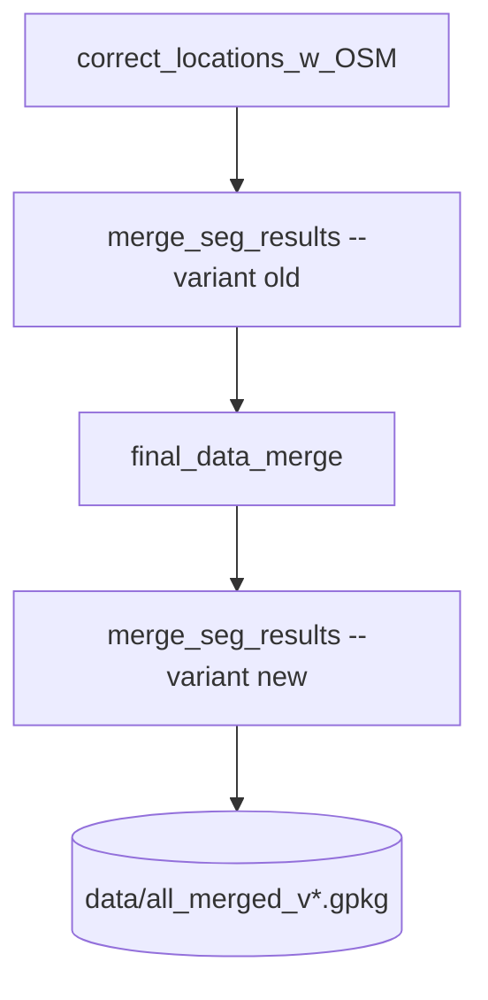
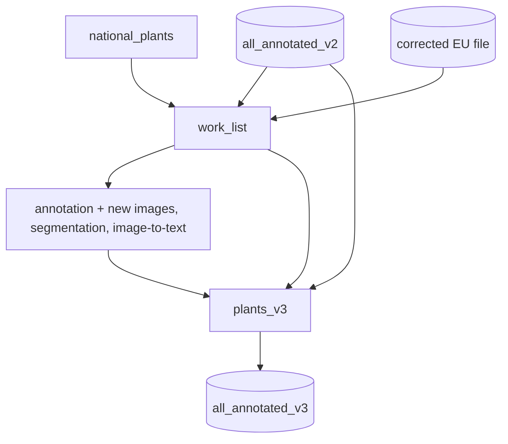

# data_merge

## Sections
| Section | Purpose |
| --- | --- |
| `What This Module Does` | Explains the aim of the merge stage |
| `How It Fits In` | Shows where this stage sits in the overall workflow |
| `Scripts in This Folder` | Summarises the role, inputs, and outputs of each script |
| `Execution Flow` | Gives a compact visual view of the merge chain |
| `Run Instructions` | Lists the commands most users will actually run |
| `Smart Behaviors` | Notes practical details about merge logic and reruns |
| `Parameters` | Collects the configuration settings specific to this stage |
| `Known Issues / TODOs` | Flags current caveats and limitations |

## What This Module Does
This module builds the plant list the rest of the pipeline reads, in two rounds:

- **v2** (`all_merged_v2.gpkg`, rule `combine_locations`): OSM-based location correction, the first
  segmentation results, the regional sources (US, EU, Canada, Germany, Thailand) and the second
  segmentation results. `merge_annotations` adds the site categories (`all_annotated_v2.gpkg`).
- **v3** (`all_annotated_v3.gpkg`): v2 updated in three steps.
  1. `national_plants.py`: plants for the countries v2 lacks (AU, CA, JP, NZ) from their national
     registers, OpenStreetMap and HydroWASTE, in v2's columns.
  2. `work_list.py`: the plants that need a new image: v2 plants without detected tanks, the national
     plants, and the plants of the corrected EU file that v2 lacks. The corrected EU file is the truth
     in its countries (locations; plants not in it are removed). This is the annotation set.
  3. `plants_v3.py`, once the new images have tank detections and site categories: removed, moved and
     new plants applied, the new results in, same sites (500 m) merged, plants without a location left
     out, every plant renumbered (`idx`; the v2 number stays in `idx_v2`).

## How It Fits In
It is the first blocking stage after raw source collection. Its outputs feed Voronoi creation, population attachment, validation, industrial analysis, and all downstream reporting.

## Required Starter Data Files

Before running this stage, these inputs must be present or configured.

| Data file | Why needed | Default path status |
| --- | --- | --- |
| Corrected HydroWASTE source | seed for location correction and merge bootstrap | `data/Enhanced_HW_WWTP__jun20_2025.geojson` (present) |
| OSM reference layer | fallback geometry for corrected locations | `data/wastewater_plant.geojson` (present) |
| Segmentation zip + mapping | first segmentation results (`merge_seg_results --variant old`) | `data/DL_results/csvv2-2.zip`, `aftersort.geojson` (present) |
| Canada extra points | final merge enrichment | `data/extra_points/Canada_14_03_2025.csv` (present) |
| Germany extra points | final merge enrichment | `data/extra_points/Germany_Hydra_waste_geospatial_corrected.geojson` (present) |
| US/EU additional sources | final merge enrichment | `final_data_source/*.geojson` paths (EU present, US missing at default) |
| Thailand extra points | final merge enrichment | `data/final_data_source/Thailand_500m_merged.geojson` (present) |

If cluster-specific segmentation results are present, override `merge_seg_results.paths.seg_results_filepath` in `wwtp/config.yaml`.

For v3 (paths in config sections `national_plants`, `work_list`, `plants_v3`):

| Data file | Why needed | Path |
| --- | --- | --- |
| National registers | AU and CA plants | `data/validation_data/national_data/register_plants.gpkg` (`snakemake national_data`) |
| Japan MLIT P22 zips | JP plants, one zip per prefecture (`P22-12_<nn>_GML.zip`) | `data/validation_data/jpn_mlit_p22/` (manual download) |
| HydroWASTE, OSM layer | AU, JP, NZ plants | `data/cleaned_hydrowaste.csv`, `data/wastewater_plant.geojson` |
| Population layer of v2 | which plants have no tanks | `data/pop_voronoi_layers/v2/lvl6/bfrep/sz/pop_added_appr_1_v2_lvl6_bfrep_sz_mult.gpkg` |
| Corrected EU file | truth for locations in Europe | `data/extra_points/final_W_europe_WWT_dec3.geojson` (not the file of the same name in `final_data_source/`) |
| New images' results | `ref.geojson` of the images, segmentation CSV (`img_name` = `<row>.png`), image-to-text CSV (`image` = `bbox_<idx>.png`) | `data/annotations/new_plants/images/ref.geojson`, `.../results/segoutput.csv`, `.../results/i2t_res.csv` |

## Scripts in This Folder
| Script | Role | What it does | Key inputs | Key outputs |
| --- | --- | --- | --- | --- |
| `correct_locations_w_OSM.py` | Python worker | Corrects WWTP geometries using OSM and corrected-source fallback | HydroWASTE, OSM geometry, Overture cache, radius | corrected point layer |
| `merge_seg_results.py` | Python worker | Merges segmentation outputs into corrected points (`--variant old`: first run, zip + mapping; `new`: one CSV by image name) | segmentation results, corrected layers | segmentation-enriched layer(s) |
| `final_data_merge.py` | Python worker | Produces the merged WWTP layer | corrected sources and country-specific files | `all_merged_v*.gpkg` |
| `national_plants.py` | Python worker | AU, CA, JP, NZ plants in v2's columns | national registers, P22, OSM, HydroWASTE | `data/national_plants/` |
| `work_list.py` | Python worker | The plants that need a new image | population layer v2, corrected EU file, national plants | `data/heigit_sizes/plants_without_size_and_new_plants.gpkg`, removed and not-added lists |
| `plants_v3.py` | Python worker | v2 updated with the work list and the new images' results | all_annotated_v2, work list, image results | `data/all_annotated_v3.gpkg`, `data/heigit_sizes/plants_v3_summary.csv` |

## Execution Flow

Snakemake runs the four steps as one job (rule `combine_locations`): they read and rewrite the same merged file in turn.



## Run Instructions
```bash
snakemake --profile workflow/profiles/slurm combine_locations
python -m wwtp.data_merge.final_data_merge --version 2       # one step on its own

# v3
snakemake --profile workflow/profiles/slurm work_list --config run_once=work_list
snakemake --profile workflow/profiles/slurm annotation_context --config run_once=annotation_context
# ... images, segmentation and image-to-text outside this workflow, then:
snakemake --profile workflow/profiles/slurm annotation_overlay --config run_once=annotation_overlay
snakemake --profile workflow/profiles/slurm plants_v3 --config run_once=plants_v3
```
Then set `create_voronoi.version` to `'3'` (the analysis reads `all_annotated_v3.gpkg`).

The log is `{data_dir}/workflow/logs/combine_locations.log`.

## Smart Behaviors
- The `combine_locations` rule always runs the merge chain in a fixed order, as one job.
- `final_data_merge.py` starts from the corrected locations with the first segmentation results (`seg_corrected_south`).
- `work_list.py` keeps every `idx` of v2 and numbers the new plants after v2's highest, in a fixed order: the same inputs give the same list. Images are named by these numbers, so `plants_v3.py` stops if `ref.geojson` of the images does not match the work list.
- `plants_v3.py`: a plant the corrected EU file moves more than `wrong_code_shift_m` (50 km) carried another plant's EU code (3 in v2: two Hungarian plants with a French and a Swiss code, one Czech position with a Slovak code). The v2 plant stays where it is and the file plant is added as a plant of its own.
- `plants_v3.py`: plants closer than 500 m become one plant (31 groups now, mostly two registered plants at one site); its location comes from the corrected EU file first, then the national registers, then v2.
- The segmentation input path is cluster-specific in `wwtp/config.yaml`, so this stage often needs a local override.

Delete the final merged GeoPackage and rerun the launcher to force a full rebuild.

## Parameters
| Config key | Default | Effect |
| --- | --- | --- |
| `correct_locations_w_OSM.rad` | `5000` | OSM search radius for geometry correction |
| `final_data_merge.threshold` | `500` | Merge threshold |
| `final_data_merge.osm_threshold` | `1000` | OSM threshold for merge logic |
| `correct_locations_w_OSM.paths.paul_corrected_filepath` | template | Pre-corrected HydroWASTE source |
| `merge_seg_results.paths.seg_results_filepath` | ⚠️ path | Segmentation CSV input |
| `final_data_merge.paths.canada_filepath` | template | Canada source file |
| `final_data_merge.paths.germany_filepath` | template | Germany source file |
| `final_data_merge.paths.us_new_filepath` | template | US source file |
| `final_data_merge.paths.eu_new_filepath` | template | Europe source file |
| `final_data_merge.paths.thailand_filepath` | template | Thailand source file |
| `work_list.same_site_distance_m` | `500` | Closer than this: the same plant (EU file, v3 merge) |
| `work_list.paths.eu_file` | template | The corrected EU file (truth) |
| `plants_v3.wrong_code_shift_m` | `50000` | A longer EU-file move: the plant had another plant's code |
| `plants_v3.location_priority` | EU file, national, v2 | Location of a merged same-site plant |

## Known Issues / TODOs
- No explicit `TODO` or `FIXME` markers were found in this module.
- `merge_seg_results.paths.seg_results_filepath` is hard-coded to a cluster path in the default config and should be overridden locally.
