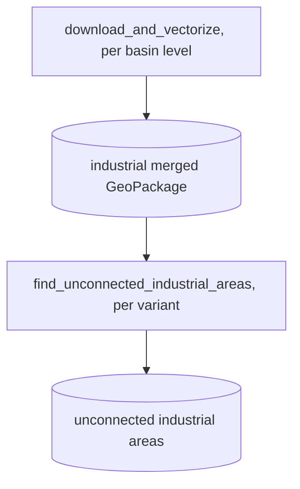

# industrial_analysis

## Sections
| Section | Purpose |
| --- | --- |
| `What This Module Does` | Explains the aim of the industrial-analysis branch |
| `How It Fits In` | Shows where this stage sits in the full workflow |
| `Scripts in This Folder` | Summarises the role, inputs, and outputs of each script |
| `Execution Flow` | Gives a compact visual view of the industrial workflow |
| `Run Instructions` | Lists the commands most users will actually run |
| `Smart Behaviors` | Notes practical details about execution and filtering |
| `Parameters` | Collects the configuration settings specific to this stage |
| `Known Issues / TODOs` | Flags current caveats and limitations |

## What This Module Does
This module measures which industrial land areas are not covered by industrial WWTP service regions. It downloads and vectorizes industrial land rasters, enriches them with watershed and country context, and then compares them to the industrial-filtered Voronoi outputs.

## How It Fits In
It runs after the main Voronoi and population stages, but it uses the same configurable Voronoi machinery with industrial WWTP categories. Its outputs feed the industrial coverage analysis branch and the reporting layers that summarize uncovered industrial polygons.

## Scripts in This Folder
| Script | Role | What it does | Key inputs | Key outputs |
| --- | --- | --- | --- | --- |
| `download_and_vectorize.py` | Python worker | Downloads and vectorizes industrial raster data | Zenodo archive, basin data, country context | merged industrial GeoPackage |
| `find_unconnected_industrial_areas.py` | Python worker | Finds industrial polygons outside service coverage | industrial polygons, corrected WWTP data, industrial categories | unconnected industrial parquet |

## Execution Flow

Snakemake rules `download_and_vectorize_lvl<level>` and `find_unconnected_industrial_areas__<variant tag>`; target `sweep_industrial` runs the second for every sweep variant.

## Run Instructions
```bash
snakemake --profile workflow/profiles/slurm all               # configured variant
snakemake --profile workflow/profiles/slurm sweep_industrial  # every variant of the sweep
python -m wwtp.industrial_analysis.find_unconnected_industrial_areas --level 6
```

## Smart Behaviors
- `download_and_vectorize.py` caches rasters when `industrial_persist_rasters=true` and can reuse the merged industrial GeoPackage when overwrite is disabled.
- `find_unconnected_industrial_areas.py` uses `industrial_category_numbers` to restrict the Voronoi branch to industrial WWTPs.
- Both scripts accept the same named override flags used by the rest of the pipeline.

Delete the industrial output directory or enable the overwrite flags to force a rerun.

## Parameters
| Config key | Default | Effect |
| --- | --- | --- |
| `download_and_vectorize.industrial_zenodo_url` | Zenodo URL | Industrial raster source |
| `download_and_vectorize.industrial_min_cells` | `100` | Minimum connected raster size |
| `download_and_vectorize.industrial_persist_rasters` | `true` | Preserve downloaded rasters |
| `download_and_vectorize.industrial_simplify_tolerance` | `0.001` | Geometry simplification tolerance |
| `download_and_vectorize.overwrite_existing` | `false` | Overwrite vectorized outputs |
| `find_unconnected_industrial_areas.industrial_category_numbers` | `[]` | Numeric filter for industrial WWTP categories |
| `find_unconnected_industrial_areas.overwrite_existing` | `false` | Overwrite unconnected outputs |
| `find_unconnected_industrial_areas.paths.industrial_unconnected_output` | template | Unconnected industrial parquet |

## Known Issues / TODOs
- No explicit `TODO` or `FIXME` markers were found in this module.
- The default industrial raster URL is external; runs require network access or a prepared local cache.
