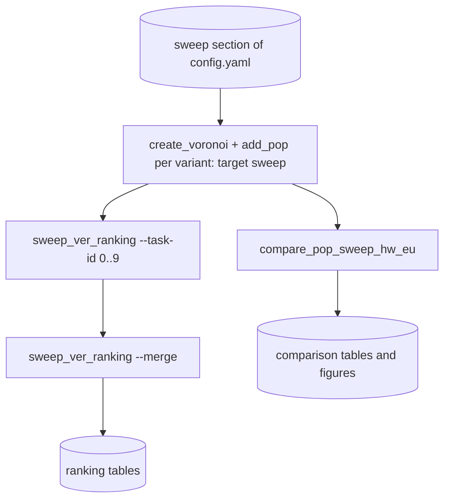

# sensitivity_analysis_scripts

## Sections
| Section | Purpose |
| --- | --- |
| `What This Module Does` | Explains the aim of the sweep and comparison stage |
| `How It Fits In` | Shows how this stage relates to the main production workflow |
| `Scripts in This Folder` | Summarises the role, inputs, and outputs of each script |
| `Execution Flow` | Gives a compact visual view of the sweep workflow |
| `Run Instructions` | Lists the commands most users will actually run |
| `Smart Behaviors` | Notes practical details about sweep logic and deduplication |
| `Parameters` | Collects the configuration settings specific to this stage |
| `Known Issues / TODOs` | Flags current caveats and limitations |

## What This Module Does
This module runs parameter sweeps and cross-run evaluation for the core model. It stress-tests level, buffer, weight method, weight function, and industrial-analysis choices so you can see how sensitive the outputs are to configuration changes.

## How It Fits In
It is an experiment and evaluation layer on top of the main pipeline. It reuses the same workers as the production flow but runs them across many parameter combinations and then scores the resulting outputs.

## Scripts in This Folder
| Script | Role | What it does | Key inputs | Key outputs |
| --- | --- | --- | --- | --- |
| `compare_pop_sweep_hw_eu.py` | Python worker | Aggregates and scores sweep outputs | population-enriched sweep layers and references | alias maps, summaries, and ranking tables |
| `sweep_ver_ranking.py` | Python worker | Scores each sweep run's verification subsets against the EU reference | verification `.gpkg` outputs and the EU reference layer | per-subset and overall ranking CSVs |

## Execution Flow

The grid is `wwtp.workflow.sweep_variants()`: every level, weighting and buffer of the `sweep` section (108 variants by default). Approach 0 does not depend on the basin level, so its layers are made once per weighting and buffer and linked to the other levels (`wwtp.workflow.approach0_source`).

## Run Instructions
```bash
snakemake --profile workflow/profiles/slurm sweep          # service areas, population, HydroWASTE/UWWTD comparison and ranking
snakemake --profile workflow/profiles/slurm sweep_layers   # only the service areas and population layers
python -m wwtp.sensitivity_analysis_scripts.sweep_ver_ranking --task-id 0   # one ranking task
```

## Smart Behaviors
- The grid has rigid buffers and size-based radii for every level and weighting. Without distance weighting (`weight_func` '') only `linear` runs, since the method has no effect; `size` weights only run with `mult`.
- Every variant is its own Snakemake rules (`create_voronoi__<tag>__a<approach>`, `add_pop__...`); Snakemake reruns only missing or outdated layers, so an interrupted sweep continues where it stopped.
- `sweep_ver_ranking` splits the grid into 10 tasks (seeded shuffle) and merges their partial metrics.

## Parameters
| Config key | Default | Effect |
| --- | --- | --- |
| `sweep.sweep_levels`, `sweep_weight_funcs`, `sweep_weight_methods`, `sweep_rigid_buffers`, `sweep_size_measures` | see config | The grid |
| `compare_pop_sweep_hw_eu.paths.eu_ref_filepath` | null | EU reference input |
| `compare_pop_sweep_hw_eu.threshold` | null | Comparison threshold |
| `compare_pop_sweep_hw_eu.hw_weight` | `0.7` | Weight of the HydroWASTE term in the combined score |
| `compare_pop_sweep_hw_eu.eu_reference_factor` | `1` | Multiplier applied to `uwwCapacity` to obtain served population |
| `sweep_ver_ranking.percent_verification` | template | Share of each run's sites used for verification |
| `sweep_ver_ranking.hw_weight` / `eu_reference_factor` | null | Inherited from `compare_pop_sweep_hw_eu` so both rankings score identically |

The former `eu_utm` key is gone: the EU reference layer's projection is now
estimated from the layer itself (`geo_utils.estimate_utm_crs`) by the shared
`load_eu_reference_layer` helper, so metre distances stay honest wherever the
reference data sits.

## Known Issues / TODOs
- No explicit `TODO` or `FIXME` markers were found in this module.
